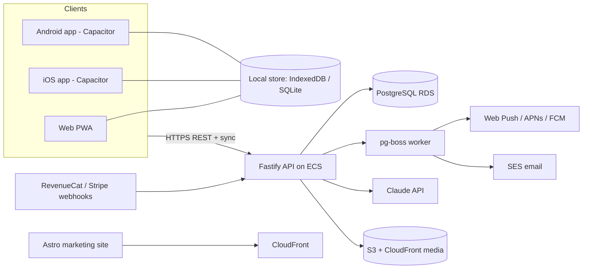

# TRD - Huru GYM
> Linked PRD v1.0 | 2026-10-10 | Strategy: evolve the existing openGym codebase, do not rewrite it
> **Beta override (see 10):** run upstream's Node API + JSON storage with Docker Compose (today on the owner's PC behind Cloudflare Tunnel, a VPS before paid launch); the Fastify/Postgres/AWS stack below is the scale-up target, adopted together with upstream's database-storage work.

## 1. Summary of decisions
| Layer | Choice | Reason |
|-------|--------|--------|
| Web (frontend) | React 19 + Vite, migrated gradually to TypeScript; Zustand and React Router kept; installable PWA | Already built and polished (offline, 12 languages, charts, icons); rewriting would cost months and add no user value |
| Mobile | Capacitor shells (iOS + Android) around the same React build, with native plugins for push, haptics, keep-awake, secure storage, SQLite, Health, share | One codebase for web, iOS and Android (FR-01 to FR-19); repo already ships a Capacitor Android app |
| Backend | Node.js + TypeScript on Fastify, Zod validation, Drizzle ORM, pg-boss job queue; REST + OpenAPI | Keeps the existing Node ecosystem and passkey library, replaces the framework-less JSON-file server with something production-grade |
| Database | PostgreSQL (managed), plus on-device storage (IndexedDB on web, SQLite on native) | JSON files cannot support multi-tenant accounts, sync, billing or backups; relational fit for plans, workouts, sets |
| Cloud deployment | AWS (ECS Fargate, RDS PostgreSQL, S3 + CloudFront, SES, Secrets Manager) behind Cloudflare DNS/WAF | Managed Postgres, backups and compliance tooling for health-adjacent data |
| Shared logic | `packages/core` (pure TypeScript): progression engine, 1RM, set/PR logic, import parsers | The same code runs on client (offline) and server (verification) |
| Billing | RevenueCat for Apple/Google subscriptions, Stripe for web; entitlements stored server-side | Store billing is required for in-app digital subscriptions |
| AI Coach | Anthropic Claude API called from the backend with structured outputs and per-user quotas | Replaces bundled CLI agents, which are meant for self-hosters, not a multi-user service |
| Marketing site | Astro static site on S3 + CloudFront | Fast, SEO-friendly, separate from the app |

## 2. Technology stack
**Web - React + Vite (TypeScript migration).** Keep the UI, router, Zustand stores, i18n, charts, and the pure functions under `frontend/src/lib/`. Add: strict TypeScript (module by module, `allowJs` during migration), TanStack Query for server data (coach, admin, billing), Workbox-style service worker hardening, Playwright end-to-end tests, Vitest unit tests (already used). *Considered:* Next.js (SSR not needed for an authenticated app; marketing site is separate), SvelteKit (rewrite cost).

**Mobile - Capacitor (iOS + Android).** The web build is the app. Native plugins: push notifications (APNs/FCM), local notifications, haptics, keep-awake, secure storage (Keychain/Keystore), SQLite, share sheet, Apple Health / Health Connect, passkeys through the platform credential APIs, in-app purchases through RevenueCat. Lock-screen rest timer: iOS Live Activity and Android ongoing notification via a small custom plugin. *Decision gate in M1:* a 1-week spike must prove 60 fps set logging, working passkeys inside the WebView, and reliable rest alerts; if it fails, fall back to React Native (Expo) sharing `packages/core`. *Considered:* React Native / Expo now (best native feel but throws away the working web UI and doubles screen code), Swift + Kotlin (two more codebases).

**Backend - Node.js (TypeScript) + Fastify.** Modular monolith with modules: auth, users, catalog, plans, workouts, sync, coach, billing, notifications, admin, privacy. Passkeys via SimpleWebAuthn (already a dependency). Jobs (reminders, emails, coach runs, data deletion) via pg-boss on the same database, so no Redis is needed at launch. *Considered:* NestJS (more structure, heavier), Go or Python (no advantage, loses shared `packages/core`).

**Database - PostgreSQL.** Migrations with Drizzle Kit using expand/contract so deploys never break running clients. One-off script migrates `db.json` and `state-<user>.json` files from existing openGym instances into the new schema. *Considered:* SQLite/Litestream (simple, but weaker for multi-writer sync and admin queries), InfluxDB/TimescaleDB (not needed; body-weight and set volume are small and relational).

**Cloud - AWS.** ECS Fargate API and worker services, RDS PostgreSQL (Multi-AZ at launch, KMS encryption, 14-day point-in-time recovery), S3 + CloudFront for exercise media, SES for email, Secrets Manager, CloudWatch. Cloudflare in front for DNS and WAF. Primary region: EU (Frankfurt) with CloudFront edge delivery worldwide; revisit if most users are elsewhere. *Considered:* a single VPS with Docker Compose (cheapest, fine for a closed beta, but add managed Postgres and backups before paid launch), Azure or Google Cloud (equivalent).

## 3. Architecture overview


**Monorepo layout (pnpm workspaces)**
```
huru-gym/
  apps/web        React + Vite app (PWA)
  apps/mobile     Capacitor iOS and Android projects (consume apps/web build)
  apps/api        Fastify API and workers
  apps/site       Astro marketing site
  packages/core   progression, 1RM, PR logic, parsers (pure TypeScript)
  packages/i18n   translations (12 languages)
  packages/ui     shared design tokens and components
  infra/          Terraform or CDK, Docker, CI workflows
  docs/           these documents, AGPL notices, runbooks
```

**Offline-first sync (FR-10, NFR-02).** Every mutable row has a client-generated UUID, `updated_at` assigned by the server, and a `deleted_at` tombstone. Clients write locally first, queue changes, and call `POST /sync/push` then `GET /sync/pull?cursor=` where the cursor is a server sequence from `sync_changes`. Rules: logged sets and body weights are append-only with idempotency keys; routines and settings use last-write-wins per row; workouts merge by id. The progression engine runs on the client for instant targets and on the server to verify.

## 4. Third-party services & APIs
| Service | Used for | Requirement |
|---------|----------|-------------|
| Apple and Google sign-in | Alternative login | FR-02 |
| Amazon SES | One-time codes, receipts, deletion confirmations | FR-02, FR-16 |
| APNs / FCM / Web Push (VAPID) | Rest alerts and reminders | FR-11 |
| Anthropic Claude API | AI Coach plan design and reviews | FR-13 |
| RevenueCat and Stripe | Subscriptions and entitlements | FR-14 |
| Apple HealthKit, Health Connect | Weight sync | FR-15 |
| Gym visual (licensed) or replacement media | Exercise demonstrations | FR-04 |
| Sentry | Crash and error reporting (PII scrubbed) | NFR-06 |
| PostHog (EU, opt-in only) | Product analytics | PRD section 5 |

## 5. Authentication & security
- **Passkeys first** (WebAuthn, discoverable credentials). `RP_ID` is `gym.adxfuel.com` in beta and the registrable domain (hurugym.com) in production; old passkeys keep working via `/.well-known/webauthn` Related Origin Requests so web and subdomains share credentials; native apps use associated domains (iOS) and Digital Asset Links (Android). Existing self-hosted passkeys do not migrate (different RP ID); users re-register.
- **Recovery and alternatives:** Apple and Google sign-in, email one-time code (hashed, 10-minute expiry, attempt-limited). Account linking by verified email only.
- **Sessions:** web uses HttpOnly Secure SameSite cookies with CSRF protection; native uses short-lived access tokens with rotating refresh tokens in Keychain/Keystore; users can view and revoke sessions.
- **Hardening:** rate limiting on auth and sync, input validation with Zod on every route, row-level ownership checks on every query, dependency scanning (Dependabot, CodeQL), SBOM per release, secrets only in Secrets Manager.
- **Admin:** passkey plus fresh re-authentication for sensitive actions; every action written to `audit_logs`.
- **Privacy by design:** body-weight and training data encrypted at rest (KMS) and never logged; AI requests contain no name or email; account deletion hard-deletes within 30 days and backups age out in 14 days; analytics opt-in only; no advertising SDKs.
- **AGPL section 13:** production runs only code published at tagged releases in the public repository; Settings links to the matching source.

## 6. Environments & deployment
- **Environments:** local (Docker Compose, like upstream), staging, production in separate AWS accounts.
- **CI (GitHub Actions):** lint, type-check, unit tests, API integration tests against a Postgres service container, web build, Playwright smoke, container build, vulnerability scan.
- **CD:** trunk-based development; PRs get web preview deployments; API deploys blue/green on ECS; database migrations run in the pipeline before traffic shifts. Weekly web releases, bi-weekly mobile releases.
- **Mobile releases:** Fastlane on GitHub Actions macOS runners to TestFlight and Play internal/closed testing; staged rollout (10%, 50%, 100%); feature flags for gradual features.
- **Infrastructure as code:** Terraform or AWS CDK; no console-only changes.
- **Self-hosting:** the Docker Compose path stays working on a best-effort basis for the community.

## 7. Performance, scalability, reliability targets
- Home renders from local data instantly; background sync completes under 2 s on 4G (NFR-01).
- API p95 under 200 ms for sync and read endpoints; sync payloads delta-only.
- Start with 2 small API tasks and one worker, Multi-AZ database; autoscale on CPU and queue depth (NFR-07).
- Exercise media served from CloudFront with long cache lifetimes and responsive sizes.
- Backups: automated daily snapshots plus point-in-time recovery; quarterly restore drill (NFR-06).

## 8. Observability
Structured JSON logs (CloudWatch), traces via OpenTelemetry for API and jobs, Sentry for web, native and API errors, uptime checks on health endpoints, dashboards for sync error rate, push delivery, coach cost, and subscription webhooks; alerts on error rate, queue depth, and failed migrations.

## 9. Risks & open questions
| Risk | Impact | Mitigation |
|------|--------|-----------|
| Gym visual media license unavailable or costly | Cannot launch library as-is | Decide in Phase 2; budget for license or commission replacement media |
| AGPL additional permission for app stores may not extend to a derivative | Store rejection or legal exposure | Counsel review; ask upstream author for written confirmation; keep source link in app |
| Passkeys inside Capacitor WebViews | Login failures on some devices | M1 spike; fallbacks (Apple/Google/email); native credential plugin |
| Apple may reject a thin web wrapper (guideline on minimum functionality) | Delay | Ship real native features: push, haptics, Health, offline SQLite, Live Activity |
| Subscription rules differ by storefront and change | Revenue and rejection risk | RevenueCat for store billing; re-check current App Review Guidelines before submission |
| Claude API cost grows with coach usage | Margin | Quotas per tier, compact structured prompts, cached plans, monthly cost alerts |
| Sync conflicts and clock skew | Lost or duplicated data | Server-assigned timestamps, idempotency keys, append-only sets, soak tests |
| Existing code quality unknown (only README read) | Estimate error | Phase 1 audit; adjust plan before development starts |
