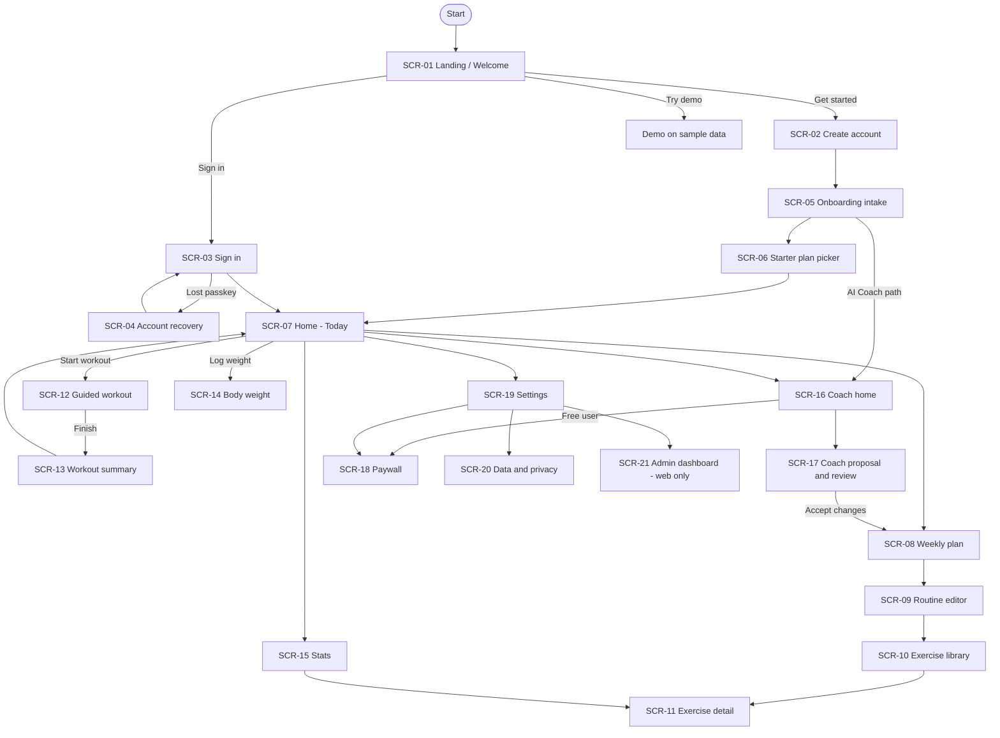

# App Flow - Huru GYM
> Linked PRD v1.0 | Components named as in `04-UIUX-DESIGN-BRIEF.md` | Native apps and web share these screens

## 1. Flow diagram

Happy path: Landing -> Create account -> Onboarding -> Starter plan -> Home -> Guided workout -> Summary.

## 2. Screen inventory
| ID | Screen | Purpose | Entry from | Exits to | FR refs |
|----|--------|---------|------------|----------|---------|
| SCR-01 | Landing / Welcome | Explain product, pricing, demo, store links (web); entry choice (app) | Launch, marketing site | SCR-02, SCR-03 | FR-19 |
| SCR-02 | Create account | Passkey, Apple, Google or email code sign-up | SCR-01 | SCR-05 | FR-01, FR-02 |
| SCR-03 | Sign in | Passkey or alternative sign-in | SCR-01 | SCR-07, SCR-04 | FR-01, FR-02 |
| SCR-04 | Account recovery | Regain access with email code or linked identity | SCR-03 | SCR-03 | FR-02 |
| SCR-05 | Onboarding intake | Goal, days per week, equipment, experience, units | SCR-02 | SCR-06, SCR-16 | FR-03, FR-17 |
| SCR-06 | Starter plan picker | Choose starter plan or build manually | SCR-05 | SCR-07 | FR-03, FR-05 |
| SCR-07 | Home - Today | Today's workout, weight, streak, sync state | Tab bar, SCR-06 | SCR-12, SCR-14, SCR-08 | FR-06, FR-08, FR-10 |
| SCR-08 | Weekly plan | Routine per weekday, reschedule a day | Tab bar | SCR-09, SCR-10 | FR-05 |
| SCR-09 | Routine editor | Exercises, supersets, targets, progression rule | SCR-08 | SCR-10 | FR-05, FR-07 |
| SCR-10 | Exercise library | Search, filter, add custom exercise | SCR-08, SCR-09 | SCR-11 | FR-04 |
| SCR-11 | Exercise detail | Media, instructions, history, e1RM | SCR-10, SCR-15 | back | FR-04, FR-09 |
| SCR-12 | Guided workout | Log sets, rest timer, PRs, effort | SCR-07 | SCR-13 | FR-06, FR-07, FR-11 |
| SCR-13 | Workout summary | Volume, PRs, muscle map, next targets | SCR-12 | SCR-07 | FR-06, FR-09 |
| SCR-14 | Body weight | Log weight, chart, goal, Health sync | SCR-07, SCR-15 | back | FR-08, FR-15 |
| SCR-15 | Stats | Heatmap, charts, PRs, muscle map | Tab bar | SCR-11 | FR-09 |
| SCR-16 | Coach home | Start intake, ask for revisions, see reviews | Tab bar, SCR-05 | SCR-17, SCR-18 | FR-13 |
| SCR-17 | Coach proposal and review | Accept or skip each change; revert | SCR-16 | SCR-08 | FR-13 |
| SCR-18 | Paywall | Plans, restore purchases, manage subscription | SCR-16, SCR-19 | back | FR-14 |
| SCR-19 | Settings | Language, units, theme, accent, notifications, effort scale, keep awake | Tab bar | SCR-20, SCR-18 | FR-11, FR-17 |
| SCR-20 | Data and privacy | Export, import, delete account, consents, analytics, source link | SCR-19 | back | FR-12, FR-16 |
| SCR-21 | Admin dashboard | Users, invites, flags, feedback (web only) | SCR-19 (admins) | back | FR-18 |

## 3. Screen specifications
**SCR-01 Landing / Welcome** - *Web:* hero, three feature rows (guided workouts, progression, privacy), pricing, FAQ, Button/Primary "Get started", Button/Secondary "Try demo", store badges. *App:* logo, tagline, Button/Primary "Get started", Text Button "Sign in". *FR:* FR-19.

**SCR-02 Create account** - Button/Primary "Continue with passkey" (name field first), Icon Buttons Apple and Google, Text Button "Use email code". Email is requested after passkey creation to enable recovery (skippable with a warning). *Errors:* passkey cancelled -> Feedback/Info with retry. *FR:* FR-01, FR-02.

**SCR-03 Sign in** - Button/Primary "Sign in with passkey" (auto-prompt on load), Apple, Google, Text Button "Email me a code", Text Button "Lost your passkey?". *FR:* FR-01, FR-02.

**SCR-04 Account recovery** - Input Field email, Button/Primary "Send code", 6-digit code Input Field, then prompt to add a new passkey. *States:* expired code, too many attempts (cooldown). *FR:* FR-02.

**SCR-05 Onboarding intake** - 4-step stepper using Segmented Control and Chips: goal (strength, muscle, fat loss, general), days per week, equipment (filter Chips), experience, units (kg/lb). Progress Bar; Text Button "Skip". Button/Secondary "Let the AI Coach design it" (Pro, trial). *FR:* FR-03, FR-17.

**SCR-06 Starter plan picker** - Cards for 4+ starter plans (upper/lower, full body, 5x5, push/pull/legs) recommended by intake answers, each with weekly schedule preview; Button/Primary "Use this plan", Text Button "Build my own". *FR:* FR-03, FR-05.

**SCR-07 Home - Today** - Header with date and sync status chip; hero Card "Today: Push day" with exercise count, estimated time, Button/Primary "Start workout"; reschedule Icon Button; weight Card with last entry and quick "Log weight"; week strip showing planned/done days; streak. *States:* rest day, no plan (CTA to starter plans), offline (banner "Offline - saved on this device"), syncing. *FR:* FR-06, FR-08, FR-10.

**SCR-08 Weekly plan** - 7-day list of routine Cards, drag to swap days, Icon Button to reschedule a single day, Button/Secondary "Exercise library". *FR:* FR-05.

**SCR-09 Routine editor** - routine name Input Field; exercise List Items with drag handles; Segmented Control or Toggle for superset pairing; per-exercise targets (sets, reps range or seconds, weight, rest); Chip showing progression rule (tap to change per routine or override per exercise); Button/Primary "Add exercise". Preview of muscles hit (muscle map thumbnail). *FR:* FR-05, FR-07.

**SCR-10 Exercise library** - Search, equipment and body-part filter Chips (options adapt so no empty results), list with thumbnail, Button "Create custom exercise" (name and body part only). *States:* loading media (skeleton), no results. *FR:* FR-04.

**SCR-11 Exercise detail** - looping demo media, step instructions in the user's language, history Card, e1RM Card with source set, progress chart, Button/Primary "Add to routine". *FR:* FR-04, FR-09.

**SCR-12 Guided workout** - exercise header with media thumbnail; Set Rows (set number, weight stepper, reps stepper, optional effort column, check button) pre-filled from last time with the target and its one-line reason; Rest Timer after each set (superset: after the pair); work timer for timed sets; Progress Bar for session; Icon Buttons for swap exercise, skip, add set; Button/Primary "Finish workout". First prompt: "Body weight today?" (skippable). Screen stays awake. *States:* offline (silent), interrupted (resume banner on reopen), PR (PR Badge with haptic). *FR:* FR-06, FR-07, FR-11.

**SCR-13 Workout summary** - duration, volume, PR list, muscle map of what was trained, next targets preview, Button/Primary "Done", Text Button "Share". *FR:* FR-06, FR-09.

**SCR-14 Body weight** - large current value, chart with goal line (week/month/year Segmented Control), list of entries, Input Field to add, Toggle "Sync with Apple Health / Health Connect". *FR:* FR-08, FR-15.

**SCR-15 Stats** - activity heatmap (year), per-exercise chart picker, PR list, e1RM, muscle map with period Segmented Control (week, month, all time) and "not trained" list. *FR:* FR-09.

**SCR-16 Coach home** - intro Card, Button/Primary "Design my plan" or "Review my progress", list of past change-sets with status; free users see a preview and Button "Unlock with Pro". First use shows a consent Dialog (what data is sent, how to revoke). *FR:* FR-13.

**SCR-17 Coach proposal and review** - summary text, list of discrete changes each with reason, Toggle or Checkbox to accept, Button/Primary "Apply selected", Button/Secondary "Revise in plain language", after applying a Toast with "Undo". *States:* generating (skeleton), failed (retry), quota reached. *FR:* FR-13.

**SCR-18 Paywall** - plan Cards (monthly, yearly), feature list, Button/Primary "Start Pro", Text Button "Restore purchases", manage-subscription link, terms and privacy links. Store billing on native; web checkout on web. *FR:* FR-14.

**SCR-19 Settings** - List Items: Profile, Language (19), Units, Theme (Segmented Control), Accent color (8 swatches), Effort scale (Off, RIR, RPE), Keep screen awake Toggle, Notifications (rest alerts, workout reminders), Subscription, Data and privacy, About (version, source code link, licenses), Sign out, Admin (if admin). *FR:* FR-11, FR-17.

**SCR-20 Data and privacy** - Export all data (JSON), Import (FitNotes, Strong, Hevy, Apple Health weight) with a results summary, Share plan (file or PDF), consent toggles (AI Coach, analytics), Button "Delete account" opening a destructive Dialog with re-authentication. *FR:* FR-12, FR-16.

**SCR-21 Admin dashboard (web only)** - tables for users (search, disable), live activity, invite codes, feature flags, feedback inbox; every action confirmed in a Dialog and audit-logged. *FR:* FR-18.

## 4. Navigation model
- **Bottom Navigation (5 tabs):** Today, Plan, Stats, Coach, Settings. Workout is launched from Today (primary button) and runs full-screen without tabs; it can be minimized and resumed.
- Web uses a left rail on screens 900 px and wider with the same five destinations.
- Auth and onboarding use a stack with no tab bar.
- Deep links: recovery entry opens SCR-04 (codes, not links), reminder notifications to SCR-07 or the active workout, rest alerts to SCR-12.
- Signed-out users opening a protected link are sent to SCR-03 and returned afterward.

## 5. States & edge cases
- **Empty:** no plan, no workouts yet, no weight entries, no coach history.
- **Loading:** skeletons for lists, charts and library; media placeholders until loaded.
- **Offline:** every logging screen works; Sync chip shows pending changes; sync resumes automatically; conflicts surface only for plan edits made on two devices (last write wins with an undo Toast).
- **Interrupted workout:** reopening the app restores the active session at the same set; sessions older than 12 hours prompt "Finish or discard".
- **Permissions:** notifications denied -> Feedback/Info with steps; Health permission denied -> sync Toggle stays off.
- **Auth edge cases:** passkey cancelled, lost device, email code expired, social account with existing email (link accounts), session revoked remotely.
- **Billing edge cases:** purchase pending, restored on a new device, expired subscription (Pro features locked, data kept), refund.
- **Coach edge cases:** consent revoked mid-session, quota reached, invalid model output (retry, never apply partial changes), revert after later edits (warn about conflicts).
- **Time edge cases:** workouts after midnight count for the local start date; timezone change keeps past logs unchanged.
- **First launch vs returning:** returning signed-in users land on SCR-07 with data from local storage immediately.
