# Backend Schema - Huru GYM
> Database: PostgreSQL (TRD). Conventions: snake_case, plural table names, `uuid` primary keys generated by the client (UUIDv7) for syncable tables, `timestamptz` timestamps, `<singular>_id` foreign keys. Replaces openGym's per-user JSON files.

## 1. Entity overview
| Table | Purpose | Supports |
|-------|---------|----------|
| users | Account, status, role | FR-01, FR-02, FR-16, FR-18 |
| passkey_credentials | WebAuthn public keys per device | FR-01 |
| auth_identities | Linked Apple / Google identities | FR-02 |
| email_codes | One-time sign-in and recovery codes | FR-02 |
| sessions | Active sessions and refresh tokens | FR-01, FR-02 |
| user_settings | Language, units, theme, accent, effort scale, consents | FR-11, FR-13, FR-16, FR-17 |
| exercises | Catalog and custom exercises | FR-04 |
| exercise_instructions | Instructions per exercise and language | FR-04 |
| routines | A workout routine with its progression rule | FR-05, FR-07 |
| routine_exercises | Exercises inside a routine (order, supersets, targets) | FR-05, FR-07 |
| plan_days | Routine assigned to each weekday | FR-05 |
| schedule_overrides | One-off rescheduled days | FR-05 |
| workouts | A logged session | FR-06, FR-10 |
| workout_sets | Logged sets (strength, timed, cardio) | FR-06, FR-07, FR-09 |
| body_weights | Weight entries (manual, imported, Health) | FR-08, FR-15 |
| push_subscriptions | Web Push endpoints and native push tokens | FR-11 |
| coach_sessions | AI Coach runs (intake, revision, review) with usage | FR-13 |
| coach_changesets | Proposed changes, snapshots, revert state | FR-13 |
| entitlements | Subscription tier and status per user | FR-14 |
| import_jobs | Import runs and their results | FR-12 |
| sync_changes | Server change feed for sync cursors | FR-10 |
| audit_logs | Security and admin actions | FR-16, FR-18 |
| invite_codes | Closed-beta and invite-only signup codes | FR-18 |
| feature_flags | Remote flags and kill switches | FR-18 |
| feedback_messages | In-app feedback inbox | FR-18 |

Personal records and estimated 1RM are derived from `workout_sets` by `packages/core` and cached on the client; they are not stored as separate tables.

## 2. ERD

```mermaid
erDiagram
  USERS ||--o{ PASSKEY_CREDENTIALS : "registers"
  USERS ||--o{ AUTH_IDENTITIES : "links"
  USERS ||--o{ EMAIL_CODES : "receives"
  USERS ||--o{ SESSIONS : "has"
  USERS ||--|| USER_SETTINGS : "configures"
  USERS ||--o{ EXERCISES : "creates custom"
  EXERCISES ||--o{ EXERCISE_INSTRUCTIONS : "described by"
  USERS ||--o{ ROUTINES : "owns"
  ROUTINES ||--o{ ROUTINE_EXERCISES : "contains"
  EXERCISES ||--o{ ROUTINE_EXERCISES : "used in"
  USERS ||--o{ PLAN_DAYS : "plans"
  ROUTINES ||--o{ PLAN_DAYS : "assigned to"
  USERS ||--o{ SCHEDULE_OVERRIDES : "reschedules"
  ROUTINES ||--o{ SCHEDULE_OVERRIDES : "moved to"
  USERS ||--o{ WORKOUTS : "logs"
  ROUTINES ||--o{ WORKOUTS : "based on"
  WORKOUTS ||--o{ WORKOUT_SETS : "contains"
  EXERCISES ||--o{ WORKOUT_SETS : "performed as"
  USERS ||--o{ BODY_WEIGHTS : "records"
  USERS ||--o{ PUSH_SUBSCRIPTIONS : "registers"
  USERS ||--o{ COACH_SESSIONS : "runs"
  COACH_SESSIONS ||--o{ COACH_CHANGESETS : "proposes"
  USERS ||--o{ COACH_CHANGESETS : "reviews"
  USERS ||--o{ ENTITLEMENTS : "holds"
  USERS ||--o{ IMPORT_JOBS : "starts"
  USERS ||--o{ SYNC_CHANGES : "generates"
  USERS ||--o{ AUDIT_LOGS : "acts in"
  USERS ||--o{ FEEDBACK_MESSAGES : "sends"
  USERS {
    uuid id PK
    string email
    timestamptz email_verified_at
    string display_name
    string status
    string role
    timestamptz created_at
    timestamptz updated_at
    timestamptz deleted_at
  }
  PASSKEY_CREDENTIALS {
    uuid id PK
    uuid user_id FK
    string credential_key
    bytea public_key
    bigint sign_count
    string transports
    string device_label
    timestamptz created_at
    timestamptz last_used_at
  }
  AUTH_IDENTITIES {
    uuid id PK
    uuid user_id FK
    string provider
    string provider_subject
    timestamptz created_at
  }
  EMAIL_CODES {
    uuid id PK
    uuid user_id FK
    string email
    string code_hash
    string purpose
    int attempts
    timestamptz expires_at
    timestamptz consumed_at
    timestamptz created_at
  }
  SESSIONS {
    uuid id PK
    uuid user_id FK
    string token_hash
    string client_info
    timestamptz expires_at
    timestamptz revoked_at
    timestamptz created_at
  }
  USER_SETTINGS {
    uuid id PK
    uuid user_id FK
    string language
    string units
    string theme
    string accent
    string effort_scale
    boolean keep_awake
    string body_figure
    numeric goal_weight_kg
    string timezone
    boolean rest_alerts_enabled
    boolean workout_reminders_enabled
    boolean analytics_opt_in
    timestamptz coach_consent_at
    timestamptz coach_consent_revoked_at
    timestamptz updated_at
  }
  EXERCISES {
    uuid id PK
    uuid user_id FK
    string slug
    string name
    string body_part
    string equipment
    string target
    string muscle_group
    string secondary_muscles
    boolean is_timed
    string media_asset
    string source
    timestamptz created_at
    timestamptz updated_at
    timestamptz deleted_at
  }
  EXERCISE_INSTRUCTIONS {
    uuid id PK
    uuid exercise_id FK
    string language
    jsonb steps
  }
  ROUTINES {
    uuid id PK
    uuid user_id FK
    string name
    string progression_rule
    string notes
    timestamptz archived_at
    timestamptz created_at
    timestamptz updated_at
    timestamptz deleted_at
  }
  ROUTINE_EXERCISES {
    uuid id PK
    uuid routine_id FK
    uuid exercise_id FK
    int position
    int superset_group
    int target_sets
    int rep_min
    int rep_max
    int target_seconds
    string progression_override
    int rest_seconds
    timestamptz updated_at
    timestamptz deleted_at
  }
  PLAN_DAYS {
    uuid id PK
    uuid user_id FK
    uuid routine_id FK
    smallint weekday
    timestamptz updated_at
    timestamptz deleted_at
  }
  SCHEDULE_OVERRIDES {
    uuid id PK
    uuid user_id FK
    uuid routine_id FK
    date on_date
    string reason
    timestamptz updated_at
    timestamptz deleted_at
  }
  WORKOUTS {
    uuid id PK
    uuid user_id FK
    uuid routine_id FK
    timestamptz started_at
    timestamptz ended_at
    date local_date
    numeric body_weight_kg
    string notes
    timestamptz created_at
    timestamptz updated_at
    timestamptz deleted_at
  }
  WORKOUT_SETS {
    uuid id PK
    uuid workout_id FK
    uuid exercise_id FK
    int position
    string set_type
    numeric weight_kg
    int reps
    int duration_s
    numeric distance_m
    numeric speed_kmh
    numeric effort_value
    string effort_scale
    boolean is_pr
    timestamptz completed_at
    timestamptz updated_at
    timestamptz deleted_at
  }
  BODY_WEIGHTS {
    uuid id PK
    uuid user_id FK
    date measured_on
    numeric weight_kg
    string source
    timestamptz created_at
    timestamptz updated_at
    timestamptz deleted_at
  }
  PUSH_SUBSCRIPTIONS {
    uuid id PK
    uuid user_id FK
    string channel
    string endpoint_or_token
    jsonb keys
    string platform
    timestamptz last_seen_at
    timestamptz created_at
  }
  COACH_SESSIONS {
    uuid id PK
    uuid user_id FK
    string kind
    string status
    jsonb input_summary
    string model
    int tokens_in
    int tokens_out
    timestamptz created_at
  }
  COACH_CHANGESETS {
    uuid id PK
    uuid user_id FK
    uuid coach_session_id FK
    string status
    jsonb plan_snapshot_before
    jsonb changes
    timestamptz created_at
    timestamptz applied_at
    timestamptz reverted_at
  }
  ENTITLEMENTS {
    uuid id PK
    uuid user_id FK
    string tier
    string source
    string status
    timestamptz current_period_end
    string store_ref
    timestamptz created_at
    timestamptz updated_at
  }
  IMPORT_JOBS {
    uuid id PK
    uuid user_id FK
    string source
    string status
    jsonb stats
    timestamptz created_at
    timestamptz finished_at
  }
  SYNC_CHANGES {
    bigint seq PK
    uuid user_id FK
    string table_name
    uuid row_key
    string op
    timestamptz changed_at
  }
  AUDIT_LOGS {
    uuid id PK
    uuid user_id FK
    string action
    string target_ref
    jsonb meta
    timestamptz created_at
  }
  INVITE_CODES {
    uuid id PK
    string code_hash
    string created_by
    string redeemed_by
    timestamptz expires_at
    timestamptz redeemed_at
    timestamptz created_at
  }
  FEATURE_FLAGS {
    string flag_key PK
    boolean enabled
    int rollout_percent
    timestamptz updated_at
  }
  FEEDBACK_MESSAGES {
    uuid id PK
    uuid user_id FK
    string category
    string message
    string app_version
    string platform
    timestamptz created_at
  }
```

## 3. Table definitions
Labeled "rec." where a column or rule is a recommendation beyond the minimum.

**users** - `email` unique when not null (lowercased); `status` in (`active`,`disabled`,`pending_deletion`); `role` in (`user`,`admin`); passkey-only accounts may have null email until recovery is set up (UI nudges to add one).

**passkey_credentials** - `credential_key` unique (base64url WebAuthn credential identifier); `sign_count` updated on each use; several rows per user.

**auth_identities** - `provider` in (`apple`,`google`); unique (`provider`, `provider_subject`).

**email_codes** - store only `code_hash`; `purpose` in (`sign_in`,`recovery`,`verify_email`); at most 5 `attempts`; purge after 24 hours.

**sessions** - stores hash of the refresh or session token; rotated on use; revoked on recovery and on "sign out everywhere".

**user_settings** - one row per user; `units` in (`metric`,`imperial`); `effort_scale` in (`off`,`rir`,`rpe`); `accent` from 8 palette keys; `body_figure` in (`male`,`female`); coach consent stored as timestamps so revocation is auditable (rec.).

**exercises** - `user_id` null means catalog entry, set means a custom exercise owned by that user; `source` in (`catalog`,`custom`); `media_asset` is the CDN key of the licensed or original media; catalog rows are read-only to clients.

**exercise_instructions** - unique (`exercise_id`, `language`); `steps` is an ordered array of strings.

**routines** - `progression_rule` in (`none`,`linear`,`greyskull_lp`,`double_progression`,`time`); soft delete via `deleted_at` for sync tombstones.

**routine_exercises** - `superset_group` null means standalone; exercises sharing the same group are logged back-to-back; `progression_override` null means follow the routine rule; `target_seconds` used for timed exercises.

**plan_days** - `weekday` 0-6; unique (`user_id`, `weekday`) among non-deleted rows; null `routine_id` is not allowed (a rest day is simply no row).

**schedule_overrides** - unique (`user_id`, `on_date`); overrides the plan for one date only.

**workouts** - `local_date` is the user's local calendar date at start; `body_weight_kg` is the weight asked at session start (optional); unique `id` makes uploads idempotent.

**workout_sets** - exactly one of reps, duration_s or distance/speed is the primary measure per `set_type` (`normal`,`warmup`,`amrap`,`timed`,`cardio`); `effort_value` is stored with its own `effort_scale` so changing the preference never rewrites history; `is_pr` is set by the client engine and re-verified server-side (rec.).

**body_weights** - `source` in (`manual`,`import`,`health`); unique (`user_id`, `measured_on`, `source`); the chart prefers manual, then health.

**push_subscriptions** - `channel` in (`webpush`,`apns`,`fcm`); `keys` holds Web Push keys; unique (`endpoint_or_token`); stale rows purged after 60 days of no use.

**coach_sessions** - `kind` in (`intake`,`revision`,`review`); `status` in (`queued`,`running`,`succeeded`,`failed`); `input_summary` holds a compact, anonymized summary of what was sent (no name or email); `tokens_in` and `tokens_out` drive per-user quotas and cost reports.

**coach_changesets** - `status` in (`proposed`,`partially_applied`,`applied`,`rejected`,`reverted`); `plan_snapshot_before` enables one-tap revert; `changes` is an array of discrete changes, each with `reason` and `accepted`.

**entitlements** - `tier` in (`free`,`pro`); `source` in (`apple`,`google`,`stripe`,`grant`); `status` in (`active`,`grace`,`expired`,`refunded`); updated only by verified webhooks (rec.: store original transaction reference in `store_ref`).

**import_jobs** - `source` in (`fitnotes`,`strong`,`hevy`,`apple_health`,`json`); `stats` lists created, matched and skipped rows.

**sync_changes** - append-only change feed; clients pull rows after their cursor `seq`; rows older than 90 days are compacted (clients older than that do a full resync).

**audit_logs** - append-only; records sign-ins on new devices, recovery, role changes, admin actions, deletion requests; retained 12 months.

**invite_codes** - used during closed beta or invite-only mode; `created_by` and `redeemed_by` hold user identifiers as plain references.

**feature_flags** - `flag_key` such as `coach_enabled` or `new_sync`; `rollout_percent` 0-100.

**feedback_messages** - read by admins; deleted with the user.

## 4. Relationships
- users 1-to-many passkey_credentials, auth_identities, email_codes, sessions, routines, plan_days, schedule_overrides, workouts, body_weights, push_subscriptions, coach_sessions, coach_changesets, entitlements, import_jobs, sync_changes, audit_logs, feedback_messages.
- users 1-to-1 user_settings.
- users 1-to-many exercises (custom only); exercises 1-to-many exercise_instructions.
- routines 1-to-many routine_exercises; exercises 1-to-many routine_exercises (many-to-many between routines and exercises through routine_exercises).
- routines 1-to-many plan_days and schedule_overrides.
- workouts 1-to-many workout_sets; exercises 1-to-many workout_sets (many-to-many between workouts and exercises through workout_sets).
- coach_sessions 1-to-many coach_changesets.

## 5. Indexes & constraints
- Foreign keys with `ON DELETE CASCADE` from every user-owned table to `users` (account deletion, FR-16); `routine_id` on workouts uses `ON DELETE SET NULL` so history survives routine deletion.
- Indexes: `workouts(user_id, local_date DESC)`, `workout_sets(workout_id, position)`, `workout_sets(exercise_id, completed_at DESC)`, `body_weights(user_id, measured_on DESC)`, `routine_exercises(routine_id, position)`, `exercises(body_part, equipment)`, full-text index on `exercises(name)`, `sync_changes(user_id, seq)`, `entitlements(user_id, status)`, `push_subscriptions(user_id)`, `audit_logs(user_id, created_at DESC)`.
- Uniques: `users(lower(email)) WHERE email IS NOT NULL` (partial), `passkey_credentials(credential_key)`, `auth_identities(provider, provider_subject)`, `exercise_instructions(exercise_id, language)`, `plan_days(user_id, weekday)`, `schedule_overrides(user_id, on_date)`, `body_weights(user_id, measured_on, source)`, `push_subscriptions(endpoint_or_token)`.
- Checks: `weight_kg >= 0`, `reps >= 0`, `weekday BETWEEN 0 AND 6`, `rep_min <= rep_max`, `effort_value BETWEEN 0 AND 10`.
- Row-level security (rec.): enable Postgres RLS keyed on the authenticated user for every user-owned table as defense in depth. Add a denormalized `user_id` to `routine_exercises` and `workout_sets` so RLS and `sync_changes` do not need joins.

## 6. Data lifecycle
- **Units:** all weights stored in kilograms and distances in meters; display conversion on the client.
- **Soft delete and tombstones:** syncable tables use `deleted_at`; tombstones purged after 90 days.
- **Account deletion (FR-16):** user row moves to `pending_deletion`, sessions revoked immediately, hard delete within 30 days cascades to all child tables, confirmation email sent; backups expire within 14 days.
- **Retention:** expired email codes purged daily; audit logs kept 12 months; coach inputs kept 90 days unless the user deletes them sooner.
- **Sensitive data:** body weight, training history and coach data are health-related: encrypted at rest, excluded from logs and analytics, included in data export.
- **Migration from openGym:** a one-time script maps `db.json` profiles and `state-<user>.json` files to these tables; existing passkeys cannot move (new RP ID), so migrated users sign in by email code and add a new passkey.
- **Migrations:** versioned, expand/contract, run in CI/CD before traffic shifts; each has a tested rollback.
