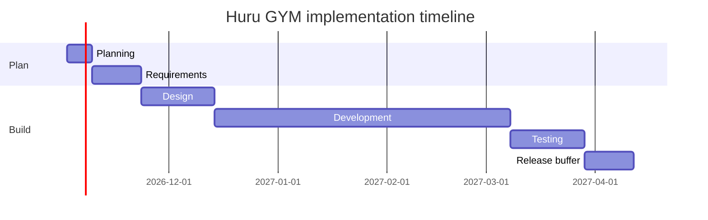

# Implementation Plan - Huru GYM
> **Superseded for timeline and team by `10-DECISIONS-AND-SOLO-PLAN.md` (solo, revenue-first, ~12 weeks to production).** Kept as the full-team reference.
> Estimates assume 3 engineers (web/frontend, backend, mobile), 1 part-time designer, 1 part-time QA from week 14, AI coding assistance, and a brownfield start from the openGym codebase. Linked: PRD v1.0, TRD, App Flow, Design Brief, Schema, `07-FORK-AND-COMPLIANCE.md`.

## 1. Timeline overview
| # | Phase | Reference range | Planned | Why this point in the range | Owner |
|---|-------|-----------------|---------|-----------------------------|-------|
| 1 | Planning | 1 week | 1 week | Fork, code audit, legal gates opened, scope fixed in PRD | Product owner + lead engineer |
| 2 | Requirements | 1-2 weeks | 2 weeks | License decisions (media, AGPL stores permission), billing and privacy design need counsel and vendor answers | Product owner + counsel |
| 3 | Design | 2-3 weeks | 3 weeks | New brand, 21 screens, paywall, onboarding and coach flows | Designer |
| 4 | Development | 4-10 weeks | 12 weeks | Above range: backend replacement, offline sync, two native apps, billing, AI Coach, compliance work | Engineers |
| 5 | Testing | 2-3 weeks | 3 weeks | Device matrix, sync soak tests, beta, security review (starts in week 16) | QA + engineers |
| - | Release buffer | - | 2 weeks | Two store reviews, possible rejections, staged rollout | All |

**Total: 23 weeks** (reference sequential range 10-19 weeks; this scope is deliberately larger than a greenfield MVP).

Indicative start Monday 2 November 2026; public launch about mid-April 2027. Store developer accounts, domain and trademark checks start in week 1 because approvals take time.

## 2. Phase details
**1. Planning (week 1).** Fork the repo into your GitHub as `huru-gym` keeping full history; audit code, dependencies and licenses; list the rename map; confirm the legal entity. *Deliverables:* repo with new name and notices intact, audit report (what to keep, refactor, replace), risk list. *Exit:* PRD scope approved; go/no-go on the media license path.

**2. Requirements (weeks 2-3).** Decide the exercise media route (license Gym visual or replace); get counsel's opinion on AGPL and the app-store permission; define billing products and quotas; finalize acceptance criteria and analytics events. *Deliverables:* signed decisions, privacy policy and terms outline, billing product list. *Exit:* every Must-have has testable acceptance criteria; stack and accounts (Apple Developer, Google Play, AWS, RevenueCat, Stripe, Anthropic) created.

**3. Design (weeks 4-6).** Brand identity, design system in Figma using the Design Brief, high-fidelity screens SCR-01 to SCR-21, prototype tested with 5 lifters. *Deliverables:* logo and icons, component library, prototype, app store assets plan. *Exit:* all screens reviewed; gym-floor usability issues closed.

**4. Development (weeks 7-18).** Milestones in section 3. *Deliverables:* working staging builds of web, iOS (TestFlight) and Android (internal testing) every milestone. *Exit:* all Must-have FRs demoable on staging; sync soak test passed.

**5. Testing (weeks 19-21, with early work from week 16).** Functional, performance (NFR-01), security (ASVS L2 checklist and external penetration test), accessibility, offline and sync, billing sandbox, deletion and export; closed beta with 50-100 users. *Exit:* no open critical or high bugs; store listings, privacy labels and legal pages final.

**Release buffer (weeks 22-23).** Submit to both stores, staged rollout (10%, 50%, 100%), launch checklist, on-call rota, support inbox ready.

## 3. Development breakdown
| Milestone | Weeks | Scope | FR refs | Demo |
|-----------|-------|-------|---------|------|
| M1 Foundations and spike | 7-8 | Monorepo, TypeScript API on Fastify, Postgres schema and migrations, CI/CD, staging on AWS, rebrand and AGPL notices, passkeys plus Apple/Google/email-code recovery, Capacitor spike (passkeys, 60 fps logging, rest alerts) with go/no-go | FR-01, FR-02, FR-16, FR-17 | Sign up and sign in on web, iOS and Android test builds; spike report |
| M2 Core training loop and sync | 9-12 | Catalog and custom exercises (licensed media), plan and routine builder, guided workout, progression engine in shared core, body weight, offline-first storage and sync, openGym data migration script | FR-04, FR-05, FR-06, FR-07, FR-08, FR-10 | Plan a week, complete a workout offline on phone, see it on laptop |
| M3 Insights, notifications, onboarding | 13-14 | Stats (heatmap, charts, PRs, e1RM, muscle map), web push and native push, rest alerts and reminders, onboarding intake with starter plans, import/export and plan sharing | FR-03, FR-09, FR-11, FR-12 | New user onboarded in under 2 minutes; rest alert with app closed |
| M4 Native apps, Health, billing | 15-16 | Capacitor iOS and Android polish, lock-screen rest timer, Apple Health and Health Connect weight sync, RevenueCat and Stripe, paywall, entitlements, restore | FR-14, FR-15 | Purchase in sandbox on both stores; weight syncs with Health |
| M5 Coach, admin, marketing, hardening | 17-18 | AI Coach on Claude API (consent, quotas, snapshots, revert), admin console and feedback inbox, Astro marketing site and demo, data export and deletion end-to-end, performance and security fixes | FR-13, FR-18, FR-19, FR-16 | Coach proposes changes accepted one by one and reverted; account deleted end-to-end |

Build order inside each milestone: schema or migration -> API with tests -> shared core logic -> screens -> analytics events and flags. Decision gate at end of M1: continue with Capacitor, or switch the mobile layer to React Native while keeping `packages/core` and the API.

## 4. Testing & release plan
- **Automated:** unit tests for progression, e1RM, PR and sync logic (highest-risk code); API integration tests with Postgres; Playwright web end-to-end; Maestro mobile flows; migration tests on a copy of real openGym data.
- **Sync soak:** simulated multi-device offline sessions with random disconnects and clock skew; target zero lost or duplicated sets.
- **Manual device matrix:** 3 iPhones (including an older model), 4 Android devices across OS versions and OEM battery managers; VoiceOver and TalkBack passes.
- **Security:** ASVS Level 2 checklist, dependency and secret scans, external penetration test before beta exit.
- **Compliance dry-run:** privacy labels and data safety forms, account deletion in-app, HealthKit usage descriptions, subscription disclosures, AGPL notices check.
- **Beta:** TestFlight and Play closed testing with 50-100 users for 2 weeks; crash and sync dashboards reviewed daily.
- **Release:** staged rollout 10% -> 50% -> 100% with kill switches in `feature_flags`; rollback plan for API (blue/green) and for mobile (disable features by flag, hotfix release).

## 5. Risks, dependencies, assumptions
| Risk / dependency | Impact | Mitigation |
|-------------------|--------|------------|
| Gym visual license not granted or too costly | Launch blocker for the library | Start in week 1; parallel plan for replacement media; launch with text instructions and fewer licensed assets if needed |
| AGPL permission for app stores does not cover a derivative | Store distribution at risk | Counsel review and written confirmation from upstream in Requirements phase |
| Passkeys in Capacitor WebViews unreliable | Sign-in friction | M1 spike; native credential plugin; Apple/Google/email fallback |
| Code quality of existing app unknown | Estimate drift | Week 1 audit; re-plan before Design ends |
| Apple rejects wrapper-like app | 1-2 week delay | Native features (push, Health, haptics, SQLite, Live Activity); thorough review notes |
| Billing rules vary by storefront and change | Rework | RevenueCat abstraction; re-read current App Review and Play policies before M4 |
| Claude API cost or quality drift | Margin and trust | Quotas, structured outputs, evaluation set of sample users, monthly cost alerts |
| Developer availability | Slip | Cut order: Could/Should items first (FR-15, FR-18, FR-12 extras), never Must-haves |
Assumption: no social features, nutrition, or wearables apps in v1.

## 6. What speeds it up / slows it down
- **Faster (about 17-19 weeks):** launch web plus Android first, add iOS after; ship AI Coach and Health sync in a later release; keep the licensed media to a smaller exercise set.
- **Slower (about 28-32 weeks):** switching mobile to React Native, building Watch apps, replacing all exercise media with custom animations, or adding social features.
